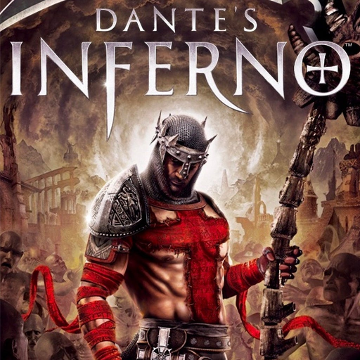

  

# Dante’s Inferno PS5 Port

Play Dante’s Inferno on a homebrew-enabled PS5. The port includes a native renderer, PlayStation button prompts, and a launcher that prepares game data from your own Xbox 360 disc image.

## Install V1.1.0

1. Download `Dantes Infero PS5 Port V1.1.0.zip` from [GitHub Releases](https://github.com/KongaTime/Dantes-Inferno-PS5-Port/releases/tag/v1.1.0).
2. Extract the `PPSA99343` folder to `/data/homebrew/` on a PS5 set up to run homebrew. Register the title with ShadowMount+.
3. Place your Xbox 360 disc ISO in `PPSA99343/dump/` and the matching raw Title Update 2 in `PPSA99343/tu/default.xexp`. Create the folders if needed.
4. Open **Dantes Inferno** on the PS5 and choose **Prepare Game**. Once preparation finishes, choose **Play Game**.

If your game files are already extracted, put them in `PPSA99343/gamedata/` with both `default.xex` and `default.xexp` at that folder’s root. The download requires your own game data and title update.

## Resolution

V1.1.0 defaults to **1440p (2560×1440)**, up from 720p. To use **4K (3840×2160)**, select **Resolution** in the Recomp launcher, press Cross or D-pad Left/Right to change it, then exit and reopen the app. The launcher remembers your choice.

When updating, close the app and copy the new package over the existing `PPSA99343` folder. Keep your existing game data and saves in place.

The native renderer, launcher-to-game handoff, and PlayStation prompts were tested on PS5 with prepared game files. ISO extraction passed host tests using a repacked image of the game files and the matching update. First-run ISO extraction on PS5 remains unverified.

## Build and source

See the [PS5 build notes](ps5/README.md) and the build-source archive on the [V1.1.0 release page](https://github.com/KongaTime/Dantes-Inferno-PS5-Port/releases/tag/v1.1.0).

## Credits

- **KongaTime** for the PS5 port and console testing.
- **florinp93 and the Hell’s Gate contributors** for the Xbox 360-to-PC recompilation this port builds on, including the original native renderer. [Hell’s Gate](https://github.com/florinp93/hells-gate-recomp)
- **The ReXGlue contributors** for the Xbox 360 recompilation tools and runtime. [ReXGlue SDK](https://github.com/rexglue/rexglue-sdk)
- **mihawk-99 and the Mesa/RADV contributors** for the Vulkan stack that runs the renderer on PS5. [PS5 Vulkan](https://github.com/mihawk-99/PS5_Vulkan)
- **The DiligentCore contributors** for the graphics framework used by the native renderer. [DiligentCore](https://github.com/DiligentGraphics/DiligentCore)
- **Kenney** for the controller icon assets used in the PlayStation prompts. [Icon license](assets/glyphs/kenney/LICENSE.txt)
